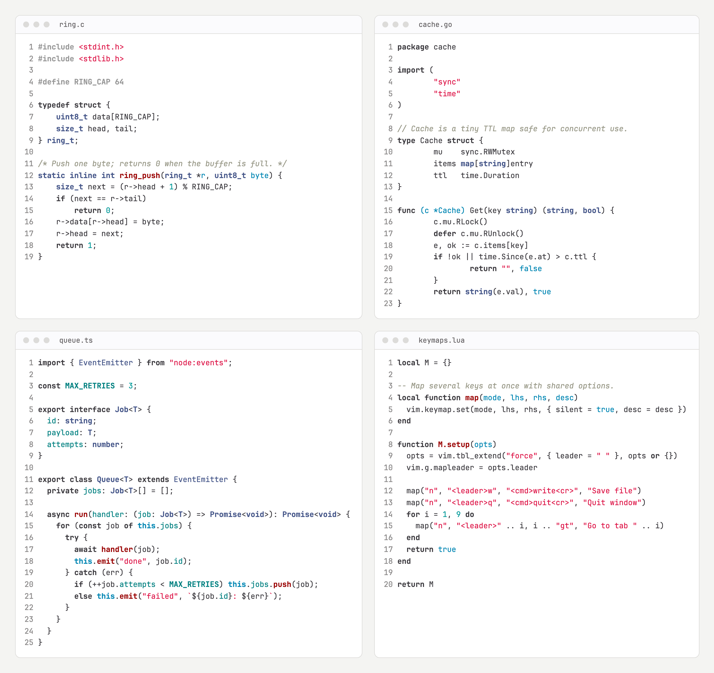
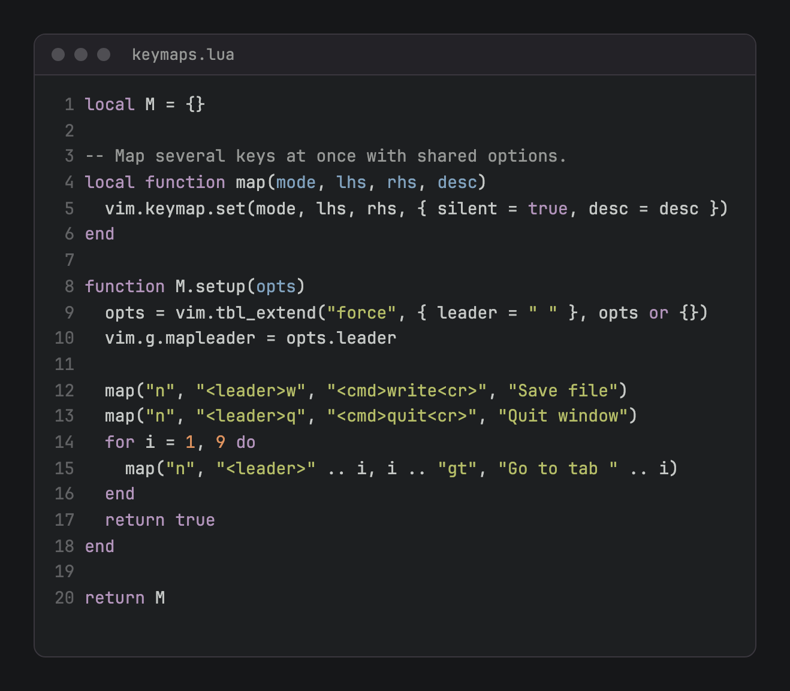
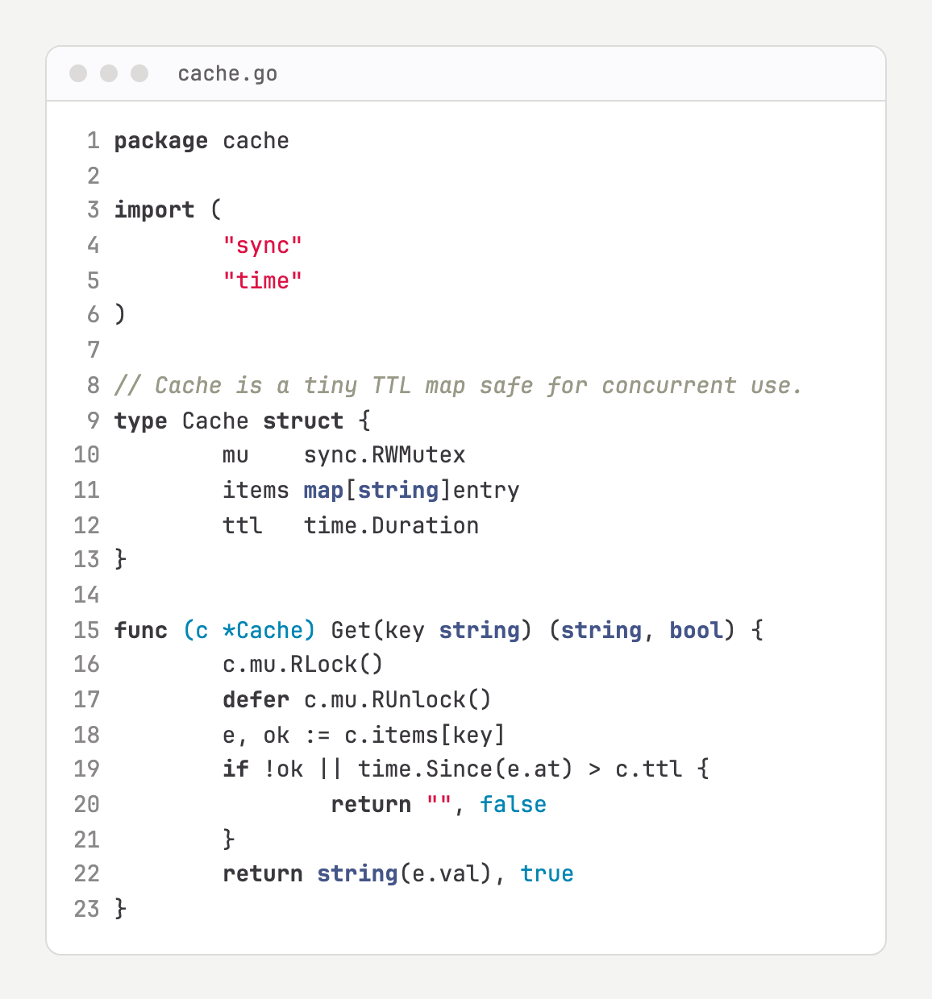
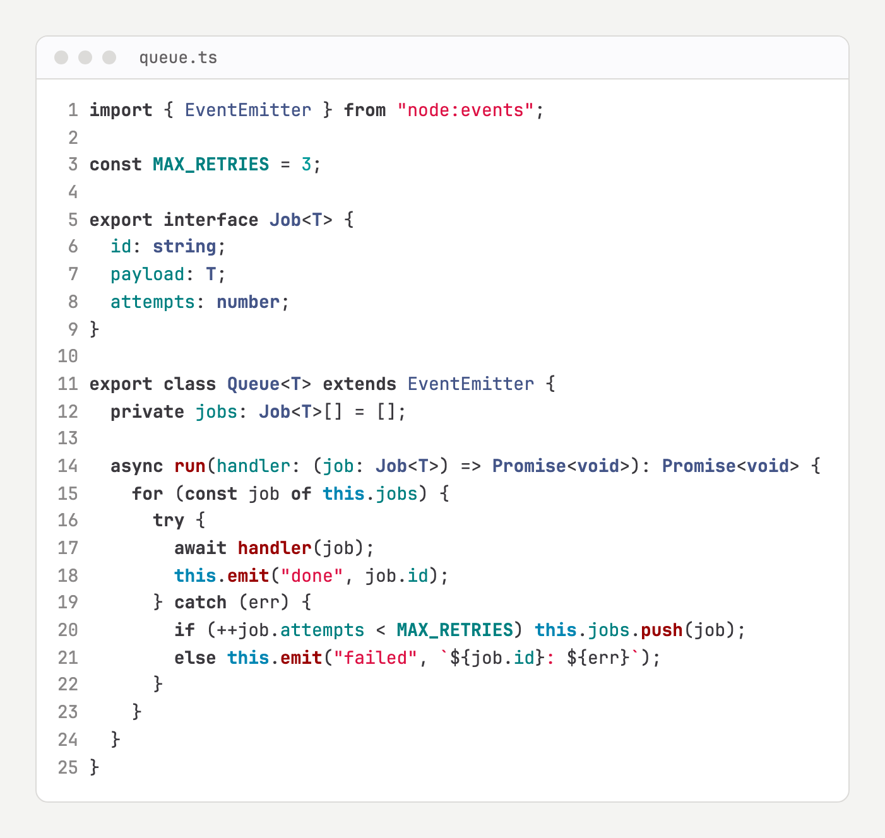

<h1 align="center">🦝 tanuki-night</h1>

<p align="center">
  GitLab's syntax highlighting for Neovim and Vim, in two styles:<br>
  <b>tanuki-night</b> (GitLab Dark) and <b>tanuki-day</b> (GitLab Light).
</p>

<p align="center">
  <a href="https://github.com/MNnazrul/tanuki-night.nvim/actions/workflows/ci.yml"></a>
  
  
  
</p>

<table>
  <tr>
    <th>🌙 tanuki-night</th>
    <th>☀️ tanuki-day</th>
  </tr>
  <tr>
    <td></td>
    <td></td>
  </tr>
</table>

If you read a lot of code in GitLab merge requests, your editor can look exactly the same.

Most themes only copy a palette. tanuki-night copies GitLab's **token rules**: which words
are colored, which are bold and which stay plain, per language. Both styles were matched
token by token against GitLab screenshots.

| Style | Command | Copies |
|---|---|---|
| 🌙 **tanuki-night** | `:colorscheme tanuki-night` | GitLab's **Dark** syntax theme (Tomorrow Night palette) |
| ☀️ **tanuki-day** | `:colorscheme tanuki-day` | GitLab's **Light** syntax theme (values from GitLab's own stylesheet) |

## ✨ Features

- **Two styles** in one plugin, switched with `:set background=light` / `dark`
- **Per-language GitLab rules** for C, C++, Rust, Zig, Python, Lua, Go, JavaScript, TypeScript,
  Vue, Ruby, Bash, CSS/SCSS, YAML, TOML, JSON, Makefile, HTML and Markdown
- **Measured, not guessed**: tanuki-day matches **96.7%** of 4,794 tokens in 40 GitLab
  screenshots (see [Development](#-development))
- Any other language still gets a complete look through generic Treesitter and Vim syntax groups
- **GitLab UI details**: current line number, merge request diff colors, search and `#L` line colors
- LSP semantic tokens are tamed, so Treesitter keeps the GitLab look
- [Plugin support](#-plugin-support) for 25 popular plugins
- Works in **Vim** too (generated `colors/*.vim`)
- [Extras](#-extras) for NvChad, lualine, kitty, Ghostty, Alacritty and WezTerm

## ⚡️ Requirements

- Neovim **0.9+** (or Vim 8+)
- A terminal with truecolor support (`termguicolors`)
- Treesitter parsers for your languages, e.g. `:TSInstall c cpp rust go python bash`.
  Without a parser, a language falls back to Vim's simpler regex highlighting, and
  tanuki-day's language rules can't apply.

## 📦 Installation

### [lazy.nvim](https://github.com/folke/lazy.nvim)

```lua
{
  "MNnazrul/tanuki-night.nvim",
  lazy = false,
  priority = 1000,
  config = function()
    vim.cmd.colorscheme("tanuki-night") -- or "tanuki-day"
  end,
}
```

To get only released versions instead of the latest `main`, add `version = "*"` to the spec.
Changes are listed in the [changelog](CHANGELOG.md) and on the
[releases page](https://github.com/MNnazrul/tanuki-night.nvim/releases).

### Built-in `vim.pack` (Neovim 0.12+)

```lua
vim.pack.add({ "https://github.com/MNnazrul/tanuki-night.nvim" })
vim.cmd.colorscheme("tanuki-night")
```

### [packer.nvim](https://github.com/wbthomason/packer.nvim)

```lua
use({
  "MNnazrul/tanuki-night.nvim",
  config = function()
    vim.cmd.colorscheme("tanuki-night")
  end,
})
```

### [vim-plug](https://github.com/junegunn/vim-plug)

```vim
Plug 'MNnazrul/tanuki-night.nvim'
" after plug#end():
colorscheme tanuki-night
```

### Vim (native packages)

```sh
git clone https://github.com/MNnazrul/tanuki-night.nvim ~/.vim/pack/themes/start/tanuki-night
```

Then add `colorscheme tanuki-night` (or `tanuki-day`) to your `.vimrc`.

## 🚀 Usage

```vim
colorscheme tanuki-night   " dark
colorscheme tanuki-day     " light
```

Switch at any time with `background`:

```vim
set background=light   " tanuki-night -> tanuki-day
set background=dark    " tanuki-day -> tanuki-night
```

## ⚙️ Configuration

Call `setup()` **before** loading the colorscheme. These are the defaults:

```lua
require("tanuki-night").setup({
  transparent = false,       -- no background on Normal, SignColumn, ...
  terminal_colors = true,    -- set vim.g.terminal_color_0..15
  gitlab_cursorline = false, -- use GitLab's "#L" highlighted-line color as CursorLine
  dim_inactive = false,      -- darker background for inactive windows
  styles = {                 -- any nvim_set_hl() attributes
    comments = {},           -- e.g. { italic = true }
    keywords = {},
    functions = {},
    strings = {},
  },
  on_colors = function(colors, style) end,         -- style is "night" or "day"
  on_highlights = function(hl, colors, style) end,
})
```

### Overriding colors and groups

```lua
require("tanuki-night").setup({
  on_colors = function(c, style)
    if style == "night" then
      c.comment = "#7f8180"
    end
  end,
  on_highlights = function(hl, c, style)
    hl.CursorLine = { bg = c.bg_alt2 }
    hl["@variable.parameter"] = "@variable" -- a string links to another group
  end,
})
```

### Using the palette

```lua
local night = require("tanuki-night").colors("night")
local day = require("tanuki-night").colors("day")
print(night.blue, day.syn_func)
```

Full docs: `:help tanuki-night`.

## 🎨 Palette

### 🌙 tanuki-night

| | | | |
|---|---|---|---|
|  `bg` `#1d1f21` |  `fg` `#c5c8c6` |  `comment` `#969896` |  `visual` `#2e3a4a` |
|  `red` `#cc6666` |  `orange` `#de935f` |  `yellow` `#f0c674` |  `green` `#b5bd68` |
|  `aqua` `#8abeb7` |  `blue` `#81a2be` |  `purple` `#b294bb` |  `cursor nr` `#453793` |

### ☀️ tanuki-day

GitLab's light theme separates tokens by weight as well as color, so bold is part of the palette.

| | | | |
|---|---|---|---|
|  `bg` `#ffffff` |  text, **keywords** `#3a383d` |  *comments* `#999988` |  **preprocessor** `#999999` |
|  strings `#dd1144` |  numbers `#009999` |  **functions** `#990000` |  **types** `#445588` |
|  params, literals `#0086b3` |  properties, constants `#008080` |  symbols `#990073` |  regex `#009926` |

## 🖼 Gallery

<details>
<summary>🌙 tanuki-night: C · Go · TypeScript · Lua</summary>



</details>

<details>
<summary>☀️ tanuki-day: C · Go · TypeScript · Lua</summary>





</details>

## 🔌 Plugin support

[gitsigns](https://github.com/lewis6991/gitsigns.nvim) ·
[telescope](https://github.com/nvim-telescope/telescope.nvim) ·
[fzf-lua](https://github.com/ibhagwan/fzf-lua) ·
[nvim-cmp](https://github.com/hrsh7th/nvim-cmp) ·
[blink.cmp](https://github.com/Saghen/blink.cmp) ·
[nvim-tree](https://github.com/nvim-tree/nvim-tree.lua) ·
[neo-tree](https://github.com/nvim-neo-tree/neo-tree.nvim) ·
[oil](https://github.com/stevearc/oil.nvim) ·
[indent-blankline](https://github.com/lukas-reineke/indent-blankline.nvim) ·
[mini.nvim](https://github.com/echasnovski/mini.nvim) ·
[snacks](https://github.com/folke/snacks.nvim) ·
[which-key](https://github.com/folke/which-key.nvim) ·
[lazy.nvim](https://github.com/folke/lazy.nvim) ·
[mason](https://github.com/williamboman/mason.nvim) ·
[noice](https://github.com/folke/noice.nvim) ·
[nvim-notify](https://github.com/rcarriga/nvim-notify) ·
[trouble](https://github.com/folke/trouble.nvim) ·
[flash](https://github.com/folke/flash.nvim) ·
[leap](https://github.com/ggandor/leap.nvim) ·
[render-markdown](https://github.com/MeanderingProgrammer/render-markdown.nvim) ·
[vim-illuminate](https://github.com/RRethy/vim-illuminate) ·
[neogit](https://github.com/NeogitOrg/neogit) ·
[diffview](https://github.com/sindrets/diffview.nvim) ·
[treesitter-context](https://github.com/nvim-treesitter/nvim-treesitter-context) ·
[lualine](https://github.com/nvim-lualine/lualine.nvim)

## 🍭 Extras

Every extra comes in both styles: `tanuki-night.*` and `tanuki-day.*`.

| Tool | Files | How to use |
|---|---|---|
| lualine | built in | `require("lualine").setup({ options = { theme = "tanuki-night" } })` |
| NvChad | [`extras/nvchad/`](extras/nvchad) | copy to `~/.config/nvim/lua/themes/`, then pick it with `<leader>th` |
| kitty | [`extras/kitty/`](extras/kitty) | `include tanuki-night.conf` in `kitty.conf` |
| Ghostty | [`extras/ghostty/`](extras/ghostty) | copy to `~/.config/ghostty/themes/`, then `theme = tanuki-night` |
| Alacritty | [`extras/alacritty/`](extras/alacritty) | `general.import = ["/path/to/tanuki-night.toml"]` |
| WezTerm | [`extras/wezterm/`](extras/wezterm) | copy to a `color_schemes_dirs` folder, then `color_scheme = "tanuki-night"` |

> **NvChad users:** also install the plugin (the lazy.nvim spec above, without `config`).
> Many GitLab rules live in the plugin's `queries/` folder, especially for tanuki-day,
> and the base46 theme file alone can't add them.

## ⚠️ Limitations

- **Vue `<script>`**: GitLab colors JavaScript inside a `.vue` file a little differently from a
  `.js` file (`this`, constants). Neovim treats both as JavaScript, so tanuki-day follows the
  `.js` rules.
- **No parser, no language rules**: a language without a Treesitter parser uses Vim's regex
  syntax, which gets the base colors but not GitLab's per-language details.
- **Bold** needs a terminal font with a bold face. tanuki-day relies on it more than night does.

## 🧪 Development

```sh
make gen           # regenerate colors/*.vim and everything in extras/
make test          # headless Neovim tests (both styles)
make test-vim      # tests for the generated Vim colorschemes
make parsers       # build Treesitter parsers for test-queries (once)
make test-queries  # check queries/*.scm against real parsers
make fmt           # format with stylua
make lint          # check formatting
```

Never edit generated files by hand. Change `lua/tanuki-night/` and run `make gen`.

| Path | What it is |
|---|---|
| `lua/tanuki-night/palette.lua`, `palette_day.lua` | colors for each style |
| `lua/tanuki-night/groups/` | highlight groups (`*_day.lua` for the light style) |
| `queries/*/highlights.scm` | extra Treesitter captures; `@tanuki.*` ones are only colored by tanuki-day |
| `scripts/gen_*.lua` | generators for Vim, NvChad and terminal themes |
| `scripts/inspect.lua` | prints the final color of every word in a file |
| `scripts/compare_light.py` | compares tanuki-day with GitLab screenshots, token by token |

How `compare_light.py` works: it reads a folder of GitLab screenshots plus a `MANIFEST.md`
(file URL and line range per screenshot), downloads each file, renders the same lines with
`scripts/tokens.lua`, measures each token's color in the screenshot with `scripts/tok.py`,
and lists the captures that disagree.

```sh
python3 scripts/compare_light.py <shots-dir> day <parser-dir> <download-cache>
```

<details>
<summary>tanuki-day agreement with GitLab Light, per language</summary>

Tokens whose color matches GitLab in the screenshots. Languages at 100% need no special
rules: the generic colors already match. Vue's lower score is explained under
[Limitations](#%EF%B8%8F-limitations).

| Language | Tokens | Match |
|---|---|---|
| C | 715 / 724 | 98.8% |
| C++ | 273 / 283 | 96.5% |
| Go | 242 / 244 | 99.2% |
| HTML | 75 / 75 | 100.0% |
| JavaScript | 234 / 236 | 99.2% |
| JSON | 55 / 55 | 100.0% |
| Lua | 279 / 280 | 99.6% |
| Makefile | 219 / 235 | 93.2% |
| Markdown | 225 / 225 | 100.0% |
| Python | 430 / 466 | 92.3% |
| Ruby | 226 / 230 | 98.3% |
| Rust | 341 / 359 | 95.0% |
| SCSS | 49 / 50 | 98.0% |
| Shell | 270 / 284 | 95.1% |
| TOML | 65 / 65 | 100.0% |
| TypeScript | 222 / 224 | 99.1% |
| Vue | 145 / 181 | 80.1% |
| YAML | 91 / 91 | 100.0% |
| Zig | 482 / 487 | 99.0% |
| **All** | **4,638 / 4,794** | **96.7%** |

</details>

## 🤝 Contributing

Issues and pull requests are welcome!

- **Found a color that differs from GitLab?** [Open a "Wrong color" issue](https://github.com/MNnazrul/tanuki-night.nvim/issues/new?template=wrong_color.yml)
  with a GitLab screenshot of the same code and the `:Inspect` output for the token.
- **Found a bug or want a feature?** [Open an issue](https://github.com/MNnazrul/tanuki-night.nvim/issues/new/choose)
  and pick a template. Please search [existing issues](https://github.com/MNnazrul/tanuki-night.nvim/issues?q=is%3Aissue) first.
- **Want to send a fix?** Read [CONTRIBUTING.md](CONTRIBUTING.md) for the setup, the code layout,
  how to fix a color or add plugin support, and the pull request checklist.

## 🙏 Credits

- [Tomorrow Night](https://github.com/chriskempson/tomorrow-theme) by Chris Kempson, the palette behind GitLab Dark
- [pygments-github-style](https://github.com/aahan/pygments-github-style), the palette behind GitLab Light
- GitLab's syntax highlighting themes, for the token rules and UI colors
- [tokyonight.nvim](https://github.com/folke/tokyonight.nvim), for structure inspiration

tanuki-night is not affiliated with or endorsed by GitLab Inc.

## 📄 License

[MIT](LICENSE)
