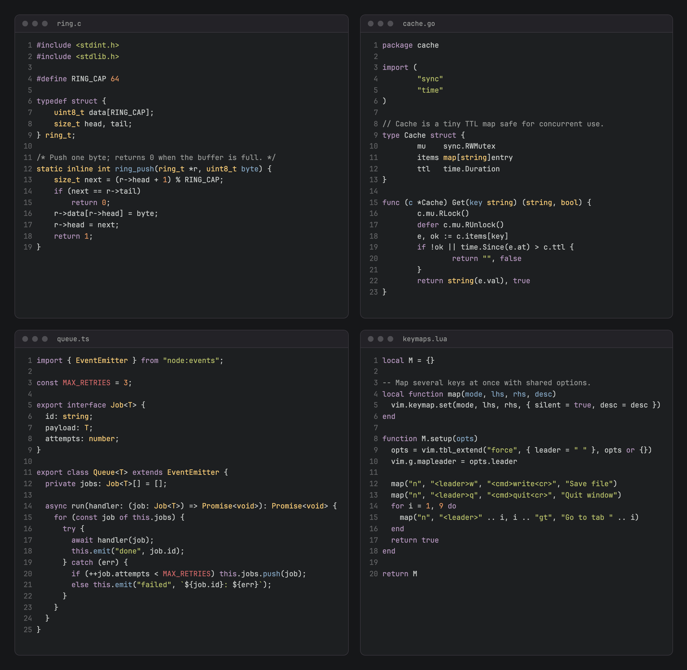
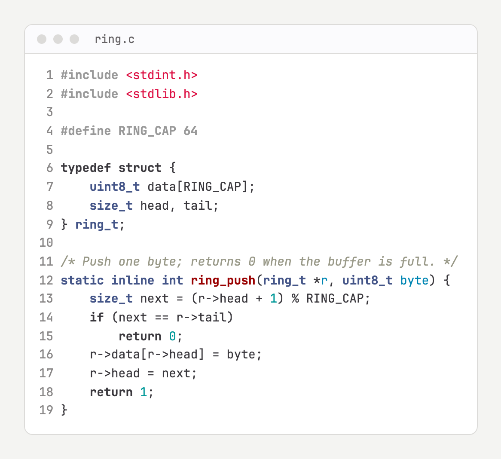
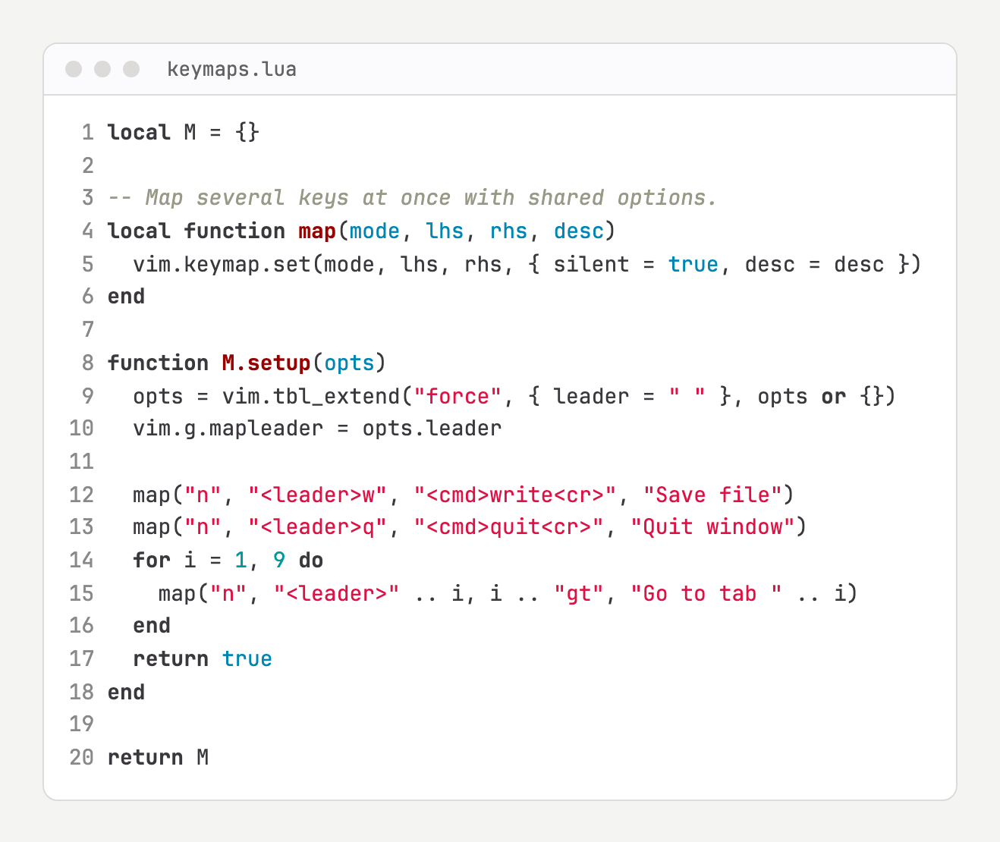
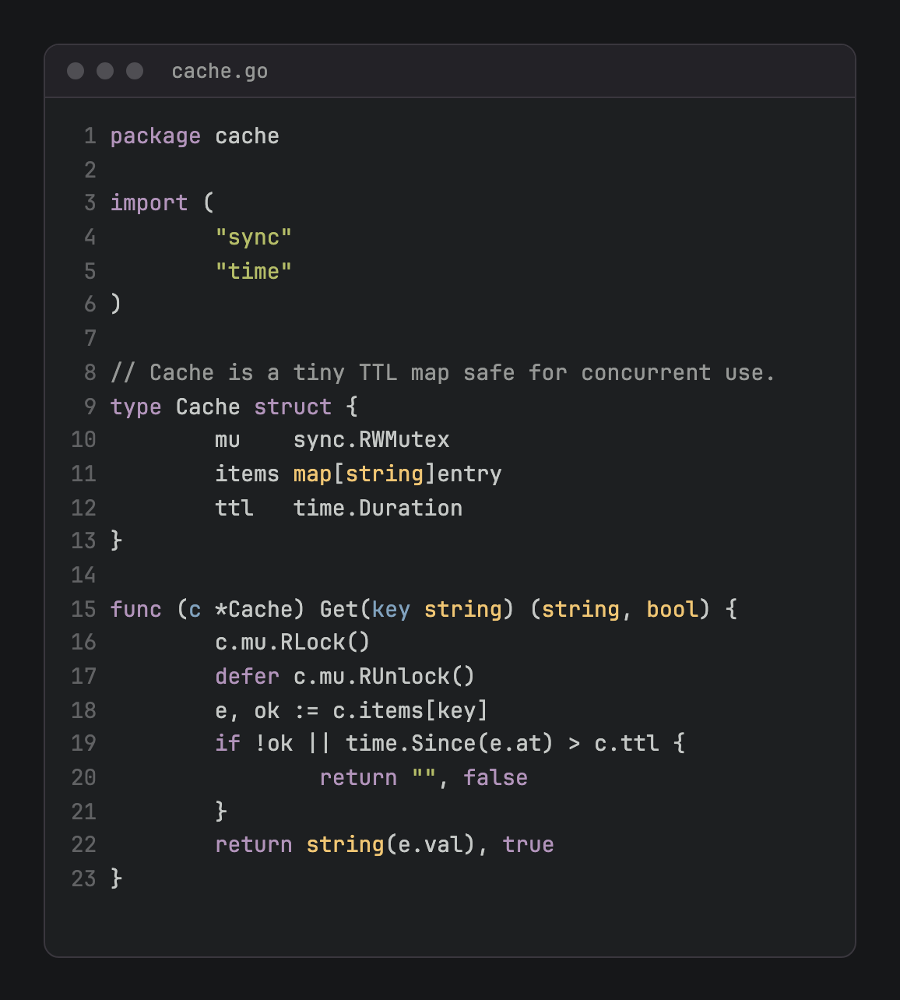
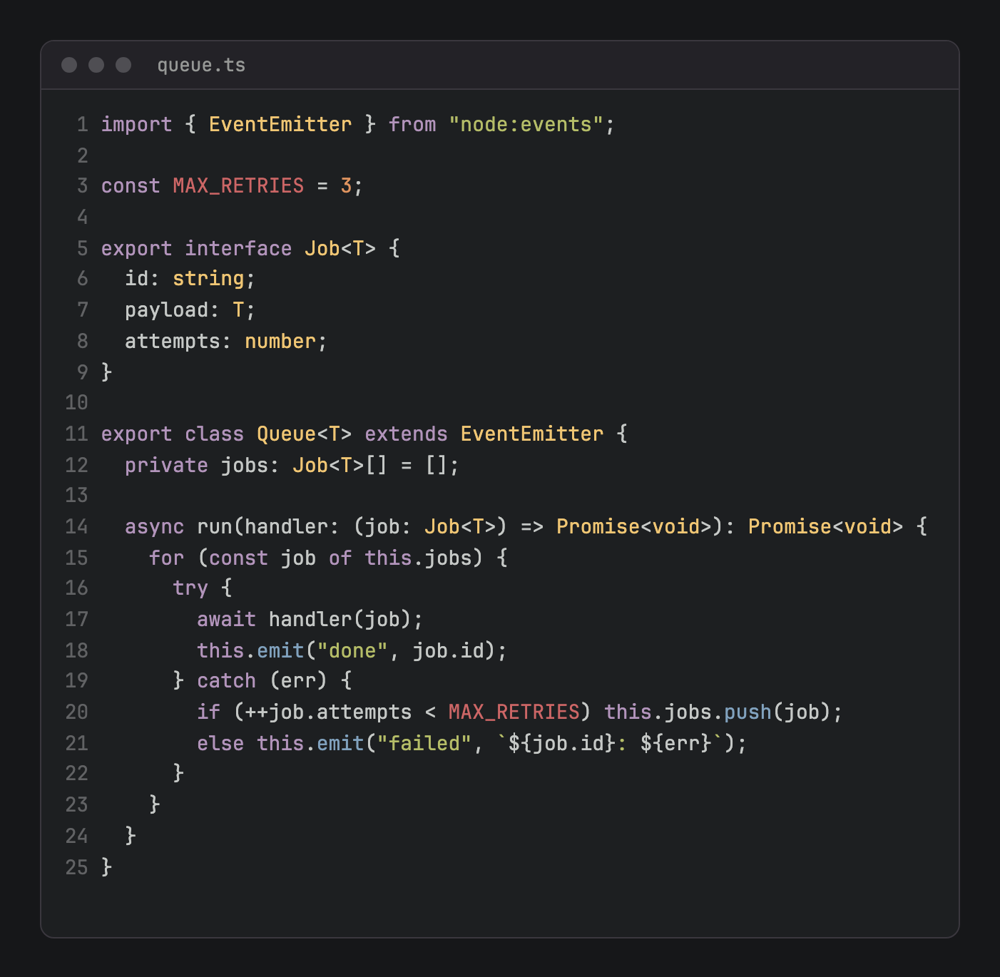

<h1 align="center">🦝 tanuki-night</h1>

<p align="center">
  GitLab's syntax themes for Neovim and Vim — <b>tanuki-night</b> (GitLab Dark) and <b>tanuki-day</b> (GitLab Light), with GitLab's own token rules.
</p>

<p align="center">
  <a href="https://github.com/MNnazrul/tanuki-night.nvim/actions/workflows/ci.yml"></a>
  
  
</p>




If you read a lot of code in GitLab merge requests, your editor can look the same.
Both styles were matched **token by token** against GitLab screenshots: which words are
colored, which are bold, which stay plain — per language, not just the palette.

| Style | Command | Based on |
|---|---|---|
| 🌙 **tanuki-night** | `:colorscheme tanuki-night` | GitLab "Dark" syntax theme (Tomorrow Night palette) |
| ☀️ **tanuki-day** | `:colorscheme tanuki-day` | GitLab "Light" syntax theme (exact values from GitLab's `_white_base.scss`) |

`:set background=light` / `dark` switches between them.

## ✨ Features

- Two styles: **night** (GitLab Dark) and **day** (GitLab Light)
- GitLab token rules for **C, C++, Rust, Zig, Python, Lua, Go, JavaScript/TypeScript, Vue, Ruby, Bash, CSS/SCSS, YAML, TOML, JSON, Makefile, HTML, Markdown**
- tanuki-day checked automatically against 40 GitLab light code screenshots (96.7% of tokens match; `scripts/compare_light.py`)
- Any other language still gets the full Tomorrow Night look through generic Treesitter and Vim syntax groups
- GitLab UI details: purple current line number, merge request diff colors, search and #L line colors
- LSP semantic tokens are tamed so Treesitter keeps the GitLab look
- Plugin support (see [below](#-plugin-support))
- Works in **Vim** too (generated `colors/tanuki-night.vim`, `colors/tanuki-day.vim`)
- Extras for **NvChad**, **lualine**, **kitty**, **Ghostty**, **Alacritty**, **WezTerm**

## ⚡️ Requirements

- Neovim **0.9+** (or Vim 8+)
- A terminal with truecolor support (`termguicolors`)
- Optional: Treesitter parsers for your languages (`:TSInstall c rust go …`) for the most accurate colors

## 📦 Installation

### [lazy.nvim](https://github.com/folke/lazy.nvim)

```lua
{
  "MNnazrul/tanuki-night.nvim",
  lazy = false,
  priority = 1000,
  config = function()
    vim.cmd.colorscheme("tanuki-night") -- or "tanuki-day"
  end,
}
```

### Built-in `vim.pack` (Neovim 0.12+)

```lua
vim.pack.add({ "https://github.com/MNnazrul/tanuki-night.nvim" })
vim.cmd.colorscheme("tanuki-night")
```

### [packer.nvim](https://github.com/wbthomason/packer.nvim)

```lua
use("MNnazrul/tanuki-night.nvim")
```

### [vim-plug](https://github.com/junegunn/vim-plug)

```vim
Plug 'MNnazrul/tanuki-night.nvim'
```

### Vim (native packages)

```sh
git clone https://github.com/MNnazrul/tanuki-night.nvim ~/.vim/pack/themes/start/tanuki-night
```

## 🚀 Usage

```vim
colorscheme tanuki-night   " dark
colorscheme tanuki-day     " light
set background=light       " switches tanuki-night -> tanuki-day (and back with =dark)
```

```lua
vim.cmd.colorscheme("tanuki-night")
```

## ⚙️ Configuration

Call `setup()` **before** loading the colorscheme. Defaults:

```lua
require("tanuki-night").setup({
  transparent = false,       -- no background on Normal, SignColumn, ...
  terminal_colors = true,    -- set vim.g.terminal_color_0..15
  gitlab_cursorline = false, -- GitLab's orange "#L" line as CursorLine
  dim_inactive = false,      -- darker background for inactive windows
  styles = {                 -- any nvim_set_hl() attributes
    comments = {},           -- e.g. { italic = true }
    keywords = {},
    functions = {},
    strings = {},
  },
  on_colors = function(colors, style) end,        -- style: "night" | "day"
  on_highlights = function(hl, colors, style) end,
})
```

### Overriding colors and groups

```lua
require("tanuki-night").setup({
  on_colors = function(c)
    c.comment = "#7f8180"
  end,
  on_highlights = function(hl, c)
    hl.CursorLine = { bg = c.bg_alt2 }
    hl["@variable.parameter"] = "@variable" -- a string links to another group
  end,
})
```

Use the palette in your own config:

```lua
local night = require("tanuki-night").colors("night")
local day = require("tanuki-night").colors("day")
```

Full docs: `:help tanuki-night`.

## 🎨 Palette

### tanuki-day (GitLab Light)

| | | | |
|---|---|---|---|
|  `bg` `#ffffff` |  `fg` / keywords **bold** `#3a383d` |  comments *italic* `#999988` |  preprocessor **bold** `#999999` |
|  strings `#dd1144` |  numbers `#009999` |  functions **bold** `#990000` |  types **bold** `#445588` |
|  params / literals `#0086b3` |  properties / constants `#008080` |  symbols `#990073` |  regex `#009926` |

### tanuki-night (GitLab Dark)

| | | | |
|---|---|---|---|
|  `bg` `#1d1f21` |  `fg` `#c5c8c6` |  `comment` `#969896` |  `visual` `#2e3a4a` |
|  `red` `#cc6666` |  `orange` `#de935f` |  `yellow` `#f0c674` |  `green` `#b5bd68` |
|  `aqua` `#8abeb7` |  `blue` `#81a2be` |  `purple` `#b294bb` |  `cursor nr` `#453793` |

## 🖼 Gallery

<details>
<summary>tanuki-day: C · Go · TypeScript · Lua</summary>





</details>

<details>
<summary>C</summary>


</details>

<details>
<summary>Go</summary>


</details>

<details>
<summary>TypeScript</summary>


</details>

<details>
<summary>Lua</summary>


</details>

## 🔌 Plugin support

[gitsigns](https://github.com/lewis6991/gitsigns.nvim) ·
[telescope](https://github.com/nvim-telescope/telescope.nvim) ·
[fzf-lua](https://github.com/ibhagwan/fzf-lua) ·
[nvim-cmp](https://github.com/hrsh7th/nvim-cmp) ·
[blink.cmp](https://github.com/Saghen/blink.cmp) ·
[nvim-tree](https://github.com/nvim-tree/nvim-tree.lua) ·
[neo-tree](https://github.com/nvim-neo-tree/neo-tree.nvim) ·
[oil](https://github.com/stevearc/oil.nvim) ·
[indent-blankline](https://github.com/lukas-reineke/indent-blankline.nvim) ·
[mini.nvim](https://github.com/echasnovski/mini.nvim) ·
[snacks](https://github.com/folke/snacks.nvim) ·
[which-key](https://github.com/folke/which-key.nvim) ·
[lazy.nvim](https://github.com/folke/lazy.nvim) ·
[mason](https://github.com/williamboman/mason.nvim) ·
[noice](https://github.com/folke/noice.nvim) ·
[nvim-notify](https://github.com/rcarriga/nvim-notify) ·
[trouble](https://github.com/folke/trouble.nvim) ·
[flash](https://github.com/folke/flash.nvim) ·
[leap](https://github.com/ggandor/leap.nvim) ·
[render-markdown](https://github.com/MeanderingProgrammer/render-markdown.nvim) ·
[vim-illuminate](https://github.com/RRethy/vim-illuminate) ·
[neogit](https://github.com/NeogitOrg/neogit) ·
[diffview](https://github.com/sindrets/diffview.nvim) ·
[treesitter-context](https://github.com/nvim-treesitter/nvim-treesitter-context) ·
[lualine](https://github.com/nvim-lualine/lualine.nvim)

## 🍭 Extras

| Tool | File | How |
|---|---|---|
Every extra comes in both styles (`tanuki-night.*` and `tanuki-day.*`).

| Tool | Files | How |
|---|---|---|
| lualine | built in | `require("lualine").setup({ options = { theme = "tanuki-night" } })` (or `"tanuki-day"`) |
| NvChad | [`extras/nvchad/`](extras/nvchad) | copy to `~/.config/nvim/lua/themes/`, pick with `<leader>th` |
| kitty | [`extras/kitty/`](extras/kitty) | `include tanuki-night.conf` in `kitty.conf` |
| Ghostty | [`extras/ghostty/`](extras/ghostty) | copy to `~/.config/ghostty/themes/`, set `theme = tanuki-night` |
| Alacritty | [`extras/alacritty/`](extras/alacritty) | `general.import = ["…/tanuki-night.toml"]` |
| WezTerm | [`extras/wezterm/`](extras/wezterm) | copy to a `color_schemes_dirs` folder, `color_scheme = "tanuki-night"` |

> NvChad users: also install the plugin (lazy spec above, without `config`) to get the
> `queries/` tweaks — tanuki-day relies on them for many GitLab-specific rules.

## 🧪 Development

```sh
make gen    # regenerate colors/*.vim and everything in extras/
make test   # headless smoke tests
make fmt    # stylua
```

Never edit generated files by hand — change `lua/tanuki-night/` and run `make gen`.

To check a token's final color without opening Neovim:

```sh
nvim --headless -u NONE -l scripts/inspect.lua tests/samples/sample.c ~/.local/share/nvim/site
```

Check tanuki-day against GitLab light screenshots (`images/light/`, not in the repo) token by token:

```sh
python3 scripts/compare_light.py images/light day <parser-rtp> <download-cache>
```

It downloads each file from GitLab, renders the same lines with `scripts/tokens.lua`,
classifies each token's color in the screenshot with `scripts/tok.py`, and lists the
captures that disagree.

Found a color that differs from GitLab? [Open an issue](https://github.com/MNnazrul/tanuki-night.nvim/issues/new/choose)
with a GitLab screenshot of the same code.

## 🙏 Credits

- [Tomorrow Night](https://github.com/chriskempson/tomorrow-theme) by Chris Kempson — the night palette
- GitLab's syntax highlighting themes — the token rules and UI colors; the light theme is
  GitLab's port of [pygments-github-style](https://github.com/aahan/pygments-github-style)
- [tokyonight.nvim](https://github.com/folke/tokyonight.nvim) — structure inspiration

tanuki-night is not affiliated with or endorsed by GitLab Inc.

## License

[MIT](LICENSE)
